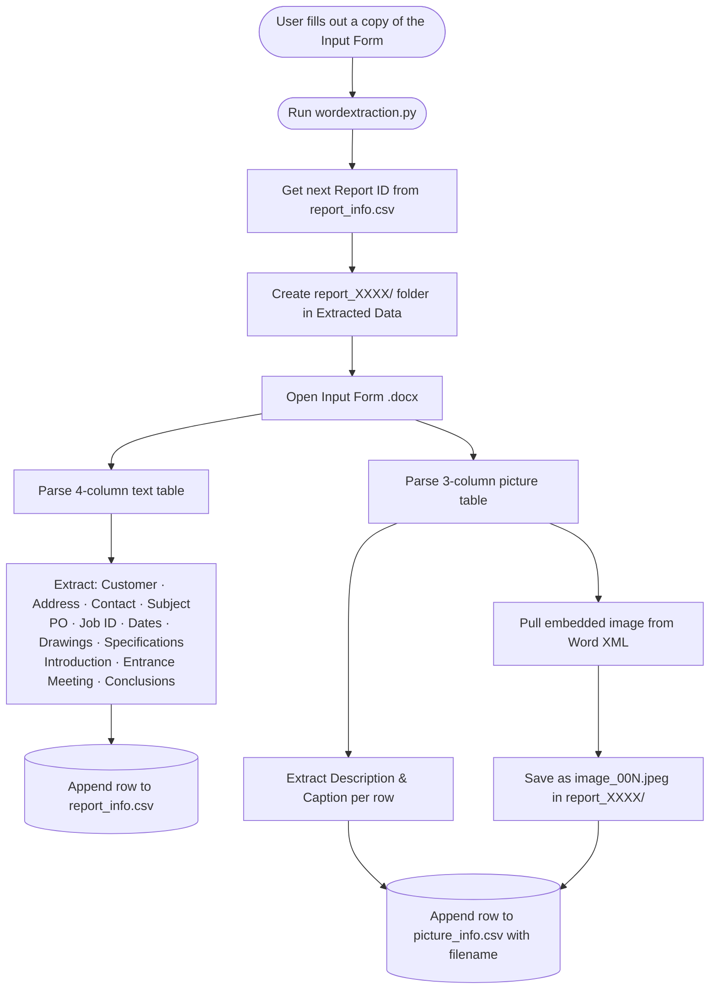
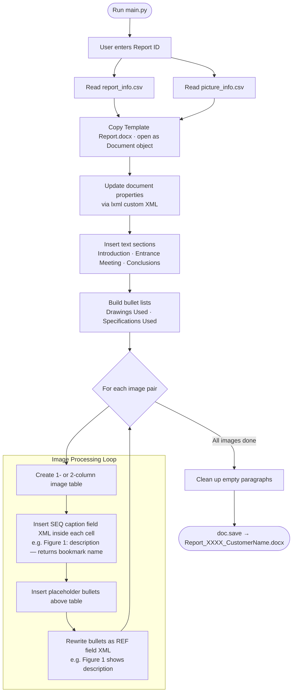

# Report Automation

Turns a filled-in Word form into a finished Maverick Applied Science inspection report (`.docx`).

You type the report text and paste the photos into a simple Word **input form**. Then you run two Python scripts. You get a formatted report with:

- the cover/header fields filled in,
- the Introduction, Entrance Meeting and Conclusions sections,
- bulleted lists of the drawings and specifications used,
- every photo laid out two per row, with numbered figure captions ("Figure 1: …"),
- one bullet per photo in the Inspection Observations section that refers to it ("**Figure 1** shows …").

You do **not** need to know Python to use it. You only run commands and edit one settings file (`.env`).

---

## Contents

1. [One-time setup](#1-one-time-setup)
2. [Making a report, step by step](#2-making-a-report-step-by-step)
3. [How to fill in the input form](#3-how-to-fill-in-the-input-form)
4. [What to change to get the result you want](#4-what-to-change-to-get-the-result-you-want)
5. [Troubleshooting](#5-troubleshooting)
6. [Project layout](#6-project-layout)
7. [How the code works (for anyone who wants to modify it)](#7-how-the-code-works-for-anyone-who-wants-to-modify-it)

---

## 1. One-time setup

You only do this once per computer. These steps are for **Windows**. The project uses `pywin32`, which only installs on Windows.

### 1.1 Install Python

Install **Python 3.11** (3.9 or newer works) from <https://www.python.org/downloads/>. In the installer, tick **"Add python.exe to PATH"**.

To check that it worked, open a terminal (PowerShell, or the terminal in VS Code) and run:

```powershell
python --version
```

### 1.2 Get the project

Use either of these:

- **Git:** `git clone https://github.com/phpaivamotta/report-automation.git`
- **Shared folder:** copy the whole `report-automation` folder to your computer. Don't copy the `.venv` folder. It belongs to the previous computer and will not work on yours.

Open a terminal **inside the `report-automation` folder** for every command below. In VS Code, use *File → Open Folder…* and then *Terminal → New Terminal*.

### 1.3 Create a virtual environment and install the packages

A virtual environment keeps this project's packages separate from the rest of your computer.

```powershell
python -m venv .venv
.venv\Scripts\Activate.ps1
pip install -r requirements.txt
```

After activation, your terminal prompt starts with `(.venv)`. **Activate it again each time you open a new terminal** (the second line above) before you run any script.

> If PowerShell says *"running scripts is disabled on this system"*, run this once and then try again:
> `Set-ExecutionPolicy -Scope CurrentUser RemoteSigned`

### 1.4 Create your `.env` settings file

The scripts read all their folder and file locations from a file named `.env` in the project folder. Each person has their own `.env`, and git doesn't track it.

1. Copy `.env.example` and name the copy `.env`:
   ```powershell
   copy .env.example .env
   ```
2. Open `.env` in any text editor and replace each placeholder with a **full path** on your computer. Spaces in the paths are fine, and you don't need quotes. Example:

```ini
# Output report template (the "look" of the final report)
TEMPLATE_DOC_PATH=C:\Users\jdoe\report-automation\Templates\Template Report.docx

# Where finished reports are saved
OUTPUT_REPORT_FOLDER_PATH=C:\Users\jdoe\report-automation\Output Report

# The filled-in input form you want to turn into a report  <-- you change this for every report
INPUT_DOC_PATH=C:\Users\jdoe\report-automation\Report Input Forms\Unit 12_20260522_095213.docx

# Where extracted text/photos are stored between the two steps
EXTRACTED_DATA_PATH=C:\Users\jdoe\report-automation\Reports Extracted Data

# (Optional step) Folder of photos to drop into a new input form  <-- change per report if you use it
INPUT_IMAGES_FOLDER_PATH=C:\Users\jdoe\Pictures\Unit 12

# (Optional step) Where the new input form is created
REPORT_INPUT_FORMS_FOLDER=C:\Users\jdoe\report-automation\Report Input Forms

# (Optional step) The blank input-form template
INPUT_FORM_TEMPLATE_PATH=C:\Users\jdoe\report-automation\Templates\Template Report Inputs Form.docx
```

You set five of these once and don't touch them again. Only **`INPUT_DOC_PATH`** changes for every report, plus **`INPUT_IMAGES_FOLDER_PATH`** if you use the optional photo step. The scripts read `.env` each time they run, so save the file and run the script again.

Setup is done.

---

## 2. Making a report, step by step

```
 Folder of photos ──(Step A, optional)──► Input form (.docx) ──(Step B: you fill it in)──►
   ──(Step C: wordextraction.py)──► Saved data + Report ID ──(Step D: main.py)──► Finished report (.docx)
```

### Step A (optional, recommended): create an input form with your photos already in it

If you have a folder of inspection photos, the script can paste them into a new input form for you, one photo per row.

1. Put the photos for this report in one folder. **They are inserted in filename order**, and that is also the order they appear in the report. Rename them (`01.jpg`, `02.jpg`, …) if you want a particular order. The script sorts numbers in filenames the way you'd expect: `2` comes before `10`.
   Supported types: `.jpg .jpeg .png .gif .bmp .tif .tiff`.
2. In `.env`, set `INPUT_IMAGES_FOLDER_PATH` to that folder.
3. Run:
   ```powershell
   python populate_input_pictures.py
   ```
4. A new form appears in `Report Input Forms\`, named `<photo folder name>_<date>_<time>.docx`. The script prints the full path.

If you skip this step, copy `Templates\Template Report Inputs Form.docx` into `Report Input Forms\` yourself and give the copy a name. Paste the photos in by hand in Step B.

> ⚠️ **Never edit the files in `Templates\` while you are making a report.** Always work on a copy.

### Step B: fill in the input form

Open the form in Word and fill it in. Section 3 below describes every field. Save and close it.

Then set **`INPUT_DOC_PATH`** in `.env` to that file's full path.

### Step C: extract the data from the form

```powershell
python wordextraction.py
```

This reads the form, saves the text and photos into `Reports Extracted Data\`, and gives the report the next **Report ID** number (1, 2, 3, …). Remember that number for Step D. Step D also shows the latest ID, so you can look it up there.

> Each run creates a **new** Report ID, even for a form you have run before. If you fix something in the form, just run Step C again and use the new ID. See [Troubleshooting](#5-troubleshooting) to clean up the old entry.

### Step D: generate the report

```powershell
python main.py
```

It asks:

```
Enter the report ID to generate (latest is 9):
```

Type the ID from Step C (usually the "latest" number) and press Enter. The report is saved as:

```
Output Report\Report_0009_<Customer_Name>.docx
```

### Step E: open the report and check it

Open the report in Word. When Word asks **"This document contains fields that may refer to other files. Update the fields?"**, click **Yes**. Word then numbers the figures and fills in the "Figure N" references.

If figure numbers show up as blank, wrong, or all the same, press **Ctrl + A**, then **F9**, to update every field.

The output is an ordinary Word document. Review it and make any final edits by hand.

---

## 3. How to fill in the input form

The input form has two tables. **Only type in the value cells. Don't change the grey/bold labels** ("Customer:", "Subject:", "Drawings provided and used…", "Description", "Caption", "Picture", and so on). The script finds each value by its label text, so a renamed label means that field comes out blank.

### Table 1: report information

| Field in the form | Where it ends up in the report |
|---|---|
| Customer, Subject, Customer Address, From, Customer Contact, Company, Inspection Site, Maverick Contact Info, Customer PO No., Maverick Job, Customer CCs, Maverick CCs, Inspection Date(s), Report Date | The header/cover fields of the report (they are stored as Word document properties). **Customer** is also used in the output filename. |
| Introduction | The paragraph under the **Introduction** heading |
| Entrance Meeting | The paragraph under the **Entrance Meeting** heading |
| Drawings provided and used… (one per row below it) | Bulleted list, each item prefixed with **"Equipment Drawing: "** |
| Specifications used… (one per row below it) | Bulleted list |
| Conclusions and Recommendations | The paragraph under **Inspection Conclusions and Recommendations** |

Tips:
- **One drawing or specification per row.** Need more rows? Click in the last drawing/spec row and use *Table Layout → Insert Below*. Delete rows you don't need, and don't leave the template's example values (`6969DWG` etc.) in.
- A drawing entry must not contain the word **"Drawing"**, and a specification entry must not contain **"Specification"**. The script skips those entries because it treats them as labels. For example, write `ABC-123 Rev 2`, not `Drawing ABC-123`. The report adds "Equipment Drawing:" for you.

### Table 2: photos (Description / Caption / Picture)

Each row is one figure in the report, and the figures follow the same order as the rows.

| Column | What to write | How it appears in the report |
|---|---|---|
| **Description** | Text that completes the sentence *"Figure N shows …"*. Start with a lowercase word and end with a period. | Bullet in Inspection Observations: **Figure 3** shows *the aeration tubes to the right of the basin entry.* |
| **Caption** | A short title for the photo. | Under the photo: *Figure 3: Aeration Tubes in the JBR Basin* |
| **Picture** | One photo (pasted in, or added by Step A). | The photo itself. |

- **The script skips any row without a picture**, so blank rows at the end are fine.
- Need more rows than the template has? Add rows to the table in Word (Step A adds them automatically).
- Paste photos as normal *in line with text* pictures. Floating or text-wrapped images may not be picked up.

---

## 4. What to change to get the result you want

| I want to… | Change this |
|---|---|
| Make a new report | Steps A–D above. Per report you only touch `.env` (`INPUT_DOC_PATH`, and `INPUT_IMAGES_FOLDER_PATH` if using Step A) and the input form. |
| Change the report text, values, or photos | The **input form**, then run Steps C and D again. |
| Change the report's look: logo, fonts, header/footer, boilerplate wording, page layout | **`Templates\Template Report.docx`**. Edit it in Word like any document. See the warning below. |
| Change the form people fill in | **`Templates\Template Report Inputs Form.docx`**. Keep the labels and the two-table layout the same, or the extraction script will stop finding the fields. |
| Change photo size in the input form | `PICTURE_WIDTH` near the top of `populate_input_pictures.py` (default 3.6 inches). |
| Change the "Equipment Drawing: " prefix, bullet fonts, or spacing | `utils.py`: `add_formatted_bullets` and the `_set_run_font` / `_set_para_spacing` helpers near the top. |
| Change photo size/layout in the final report | `utils.py`: `add_table_with_images`. |
| Change the output filename | `main.py`: the line that builds `output_file_name`. |
| Start Report IDs over from 1 | Delete (or move somewhere safe) `report_info.csv`, `picture_info.csv` and the `report_XXXX` folders in `Reports Extracted Data\`. |

> ⚠️ **Editing `Template Report.docx`:** the code finds where to insert content by searching for these exact phrases in the template. **Do not reword, delete, or merge them**, though you can restyle them:
>
> - `Introduction`
> - `Entrance Meeting`
> - `The following drawings were provided and used during the inspection:`
> - `The following specifications were used during the inspection:`
> - `Inspection Observations:`
> - `Inspection Conclusions and Recommendations`
>
> The header/cover fields come from Word **custom document properties** (*File → Info → Properties → Advanced Properties → Custom*). Keep the property names `customer address`, `inspection site`, `customer po num`, `customer ccs`, `inspection date`, `maverick ccs`, `report date` and `customer contacts`. The Title, Author, Subject and Keywords properties are also filled in.
>
> Always keep a backup of the template before you edit it, and test with an existing report ID afterwards.

---

## 5. Troubleshooting

| Problem | Fix |
|---|---|
| `ModuleNotFoundError: No module named 'docx'` (or `dotenv`) | The virtual environment isn't active. Run `.venv\Scripts\Activate.ps1`, or run `pip install -r requirements.txt`. |
| `Input DOCX file not found` / `TypeError: ... NoneType` | `.env` is missing, misnamed (it must be exactly `.env`, not `.env.txt`), or a path in it is wrong. Check each path in File Explorer. |
| `PermissionError` when generating the report | The output report (or input form) is open in Word. Close it and run again. |
| A section, the drawings, or the photos are missing from the report, and the terminal says `Header '…' not found` | Someone changed one of the protected phrases in `Template Report.docx` (see section 4). |
| A field in the report is blank | Its label in the input form was changed, or the value cell was left empty. |
| A drawing/specification is missing | It contains the word "Drawing"/"Specification" (see section 3). |
| A photo is missing | That row's picture is floating instead of in line with text, or the row has no picture. |
| Figure numbers are wrong or blank | In Word: **Ctrl + A**, then **F9**. |
| I ran `wordextraction.py` twice for the same form | Nothing breaks, it just used two IDs. Generate from the newest ID. To tidy up, delete the extra row from `report_info.csv`, its rows from `picture_info.csv` (the `Report ID` column), and its `report_XXXX` folder. Close the CSVs in Excel before running the scripts again. |
| Re-generating overwrote my edited report | `main.py` overwrites `Report_XXXX_<Customer>.docx` if it exists. Rename reports you've hand-edited, or move them out of `Output Report\`. |

---

## 6. Project layout

```
report-automation/
├── populate_input_pictures.py   # Step A – puts a folder of photos into a new input form
├── wordextraction.py            # Step C – reads the input form, saves data + photos, assigns Report ID
├── main.py                      # Step D – builds the final report from the saved data
├── utils.py                     # Helper functions used by main.py (all the Word formatting logic)
├── requirements.txt             # Python packages to install
├── .env.example                 # Copy to .env and fill in your paths
├── .env                         # Your personal paths (not in git)
│
├── Templates/
│   ├── Template Report.docx               # The look/boilerplate of the final report
│   ├── Template Report Inputs Form.docx   # The blank form people fill in
│   └── Example Report.docx                # A finished example, for reference
│
├── Report Input Forms/          # Filled-in input forms (yours)
├── Reports Extracted Data/      # Created by Step C: report_info.csv, picture_info.csv, report_XXXX/ photo folders
└── Output Report/               # Created by Step D: finished reports
```

Git doesn't track the contents of the last three folders, so each person keeps their own.

---

## 7. How the code works (for anyone who wants to modify it)

All document editing uses **python-docx** plus hand-built Word XML (**lxml**). Microsoft Word doesn't need to be running and isn't automated. Figure captions are Word `SEQ Figure` fields with a bookmark (`_Ref_Fig_N`), and the "Figure N shows…" bullets are `REF` fields that point at those bookmarks. Word fills in the numbers when the document is opened or the fields are updated.

The two main steps are connected only through the CSV files in `Reports Extracted Data\`, so you can re-generate any past report by its ID without the original form.

### `wordextraction.py`: input form → CSV + images



The form's first table is read row by row. python-docx reports merged cells as repeated values, which is why the code de-duplicates the drawing/spec lists. Picture rows are recognized because they have exactly 3 cells.

### `main.py`: CSV + images → report



The document is opened once, changed in memory, and saved once at the end. `main.py` keeps a `figure_counter` and passes it to both the caption and the cross-reference functions so they stay in sync.

### `utils.py` function reference

| Function | Purpose |
|---|---|
| `update_document_properties(doc, report_data)` | Fills core + custom Word document properties |
| `insert_formatted_text_after_header(doc, header, text)` | Inserts a formatted paragraph after a heading |
| `add_formatted_bullets(doc, header, items, is_drawing)` | Replaces the template bullet with the list; prefixes drawings with `"Equipment Drawing: "` |
| `add_table_with_images(doc, header, counter, cols, img1, img2)` | Creates a 1- or 2-column image table, returns the `Table` |
| `add_caption_paragraph(after_elem, caption, fig_idx)` | Inserts a `SEQ` caption with a bookmark, returns `(bookmark_name, xml_element)` |
| `add_bullets_above_tables(doc, table, cols)` | Inserts placeholder bullets above an image table |
| `build_cross_reference_bullet(para, desc, bm_name, fig_idx)` | Turns a placeholder bullet into a bold `REF` field + " shows …" |
| `remove_empty_paragraphs_after_table(doc)` | Removes blank paragraphs after image tables |
| `remove_first_empty_paragraph_above_text(doc, text)` | Removes a leading blank line above a given paragraph |

There are no automated tests. To check a change, re-generate an existing Report ID and compare the result with an earlier output in Word.
